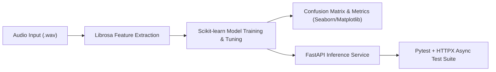

# Fine-Tune Spike — Audio & ML Evaluation Harness

> *Systematic FastAPI + Librosa + Scikit-learn fine-tuning and evaluation spike with automated API tests.*

## Problem Statement
Off-the-shelf audio and ML models underperform on domain-specific acoustic classification tasks without structured feature extraction, fine-tuning, and quantitative error analysis.

## Architecture



## Tech Stack
- **API & Testing:** FastAPI, Uvicorn, Pytest, `pytest-asyncio`, HTTPX
- **Audio & ML:** Librosa, SoundFile, Scikit-learn, NumPy
- **Visualization & Storage:** Matplotlib, Seaborn, SQLite

## Quick Start
```bash
pip install -r requirements.txt
pytest -v
uvicorn main:app --reload
```
